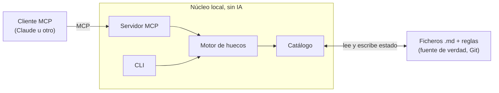

# appLinkedIn

Planificador local de contenido para LinkedIn: centraliza tus artículos y publicaciones en Markdown, aplica la cadencia que tú definas por serie y te dice qué huecos tienes libres en el calendario. Se usa desde un asistente de IA (Claude u otro cliente compatible con MCP) o desde la línea de comandos.

> **Estado: en diseño.** Este repositorio contiene de momento el estudio de viabilidad y las decisiones de alcance. El código de la v1 todavía no existe. Ver [docs/estudio-viabilidad.md](docs/estudio-viabilidad.md).

## Qué hace (y qué no)

LinkedIn ya resuelve gratis el último paso: programar y publicar una pieza terminada. appLinkedIn cubre lo que pasa **antes**:

| Hace | No hace |
| --- | --- |
| Catálogo de piezas a partir de tus ficheros `.md` | Programar publicaciones (para eso está el programador nativo de LinkedIn) |
| Reglas de cadencia por serie (p. ej. "los martes") | Leer, sincronizar ni analizar datos de LinkedIn |
| Buscar huecos libres, choques y piezas bloqueadas | Controlar el navegador sobre LinkedIn |
| Estado de cada pieza: idea, borrador, listo, programado, publicado | Publicar carruseles por API (no está soportado) |
| Exponer todo lo anterior como servidor MCP | Guardar tokens ni datos en ningún servidor |

## Arquitectura



- **El núcleo no llama a ningún modelo de IA.** Calcula huecos y estados de forma determinista y se prueba con tests.
- **La IA vive en el cliente.** Tú no pagas nada por usar la herramienta; quien quiera conectarla a una IA de pago lo hace con su propio cliente o clave.
- **Tus ficheros son la base de datos.** Los metadatos van en un bloque YAML al inicio de cada `.md`; las reglas de cadencia, en un fichero de configuración.

## Hoja de ruta

**v1 (MVP)**

1. Catálogo desde una carpeta de `.md` con metadatos (serie, estado, fecha prevista, fecha publicada, URL).
2. Reglas de cadencia por serie.
3. Buscador de huecos: próximas fechas libres, choques, piezas bloqueadas.
4. Servidor MCP local (stdio) y CLI mínima.
5. Skill de ejemplo con criterios editoriales para el asistente.

**v2 (solo si la v1 se usa de verdad)**

- Editor visual local con vista previa tipo LinkedIn (recuento de caracteres, corte del "ver más", carrusel).
- Publicar ahora y editar el texto de un post propio por la API oficial de LinkedIn (permiso `w_member_social`, autoservicio).
- Detección de carruseles por convención de nombres y aviso de tarjetas que faltan.
- Abrir cada pieza en LinkedIn con un enlace en el navegador predeterminado.

## Instalación

> Pendiente de la v1. Los requisitos concretos dependen del stack, que aún no está decidido (.NET o TypeScript).

El flujo previsto será:

1. Clonar el repositorio.
2. Compilar o instalar el paquete según el stack elegido.
3. Indicar la carpeta donde están tus `.md` y el fichero de reglas de cadencia.
4. Registrar el servidor MCP en tu cliente. En Claude Desktop, añadiendo una entrada en `claude_desktop_config.json`:

```json
{
  "mcpServers": {
    "applinkedin": {
      "command": "<comando del servidor, se definirá en la v1>",
      "args": ["--content", "C:\\ruta\\a\\tus\\articulos"]
    }
  }
}
```

5. Reiniciar el cliente y comprobar que aparecen las herramientas de appLinkedIn.

## Estructura del repositorio

```
applinkedin/
├── README.md
├── LICENSE                     Apache License 2.0
├── NOTICE
└── docs/
    └── estudio-viabilidad.md   Análisis previo y decisiones de alcance
```

## Aviso

Proyecto personal e independiente. No está afiliado, patrocinado ni respaldado por LinkedIn Corporation. LinkedIn es una marca registrada de LinkedIn Corporation.

## Licencia

Distribuido bajo la [Apache License 2.0](LICENSE). Ver también [NOTICE](NOTICE).
