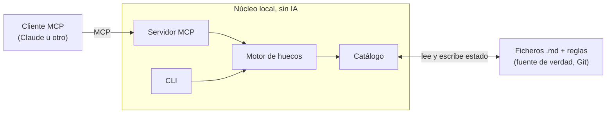

# appLinkedIn

Planificador local de contenido para LinkedIn: centraliza tus artículos y publicaciones en Markdown, aplica la cadencia que tú definas por serie y te dice qué huecos tienes libres en el calendario. Se usa desde un asistente de IA (Claude u otro cliente compatible con MCP) o desde la línea de comandos.

> **Estado: en desarrollo.** La v1 se está construyendo historia a historia; este README recoge el alcance y la arquitectura decididos.

## Qué hace (y qué no)

LinkedIn ya resuelve gratis el último paso: programar y publicar una pieza terminada. appLinkedIn cubre lo que pasa **antes**:

| Hace | No hace |
| --- | --- |
| Catálogo de piezas a partir de tus ficheros `.md` | Programar publicaciones (para eso está el programador nativo de LinkedIn) |
| Reglas de cadencia por serie (p. ej. "los martes") | Leer, sincronizar ni analizar datos de LinkedIn |
| Buscar huecos libres, choques y piezas bloqueadas | Controlar el navegador sobre LinkedIn |
| Estado de cada pieza: idea, borrador, listo, programado, publicado | Publicar carruseles por API (no está soportado) |
| Exponer todo lo anterior como servidor MCP | Guardar tokens ni datos en ningún servidor |

## Arquitectura



- **El núcleo no llama a ningún modelo de IA.** Calcula huecos y estados de forma determinista y se prueba con tests.
- **La IA vive en el cliente.** Tú no pagas nada por usar la herramienta; quien quiera conectarla a una IA de pago lo hace con su propio cliente o clave.
- **Tus ficheros son la base de datos.** Los metadatos van en un bloque YAML al inicio de cada `.md`; las reglas de cadencia, en un fichero de configuración.

## Hoja de ruta

**v1 (MVP)**

1. Catálogo desde una carpeta de `.md` con metadatos (serie, estado, fecha prevista, fecha publicada, URL).
2. Reglas de cadencia por serie.
3. Buscador de huecos: próximas fechas libres, choques, piezas bloqueadas.
4. Servidor MCP local (stdio) y CLI mínima.
5. Skill de ejemplo con criterios editoriales para el asistente.

**v2 (solo si la v1 se usa de verdad)**

- Editor visual local con vista previa tipo LinkedIn (recuento de caracteres, corte del "ver más", carrusel).
- Publicar ahora y editar el texto de un post propio por la API oficial de LinkedIn (permiso `w_member_social`, autoservicio).
- Detección de carruseles por convención de nombres y aviso de tarjetas que faltan.
- Abrir cada pieza en LinkedIn con un enlace en el navegador predeterminado.

## Instalación

Requiere .NET 10. El [manual de instalación y uso](docs/manual.md) explica todos los pasos: compilar, preparar tu carpeta de contenido y el fichero de series, conectar con Claude Desktop y comprobar que funciona. Resumido:

1. Clona el repositorio y publica el servidor con `dotnet publish back/src/Ali.Mcp -c Release -o publicado/mcp`.
2. Copia la carpeta [`ejemplo/`](ejemplo/) como punto de partida para tus `.md` y tu `series.yaml`.
3. Añade el servidor a `claude_desktop_config.json`: comando `dotnet` y argumentos `<ruta>/publicado/mcp/ali-mcp.dll --contenido <tu carpeta>`.
4. Reinicia Claude Desktop y comprueba que aparecen las cinco herramientas de appLinkedIn.

## Estructura del repositorio

```
applinkedin/
├── README.md
├── LICENSE                     Apache License 2.0
├── NOTICE
├── CLAUDE.md                   Instrucciones para asistentes de IA
├── global.json                 SDK de .NET 10 y ejecutor de pruebas
├── ejemplo/                    Carpeta de contenido de ejemplo (series y piezas)
├── back/
│   ├── Ali.slnx                Solución .NET
│   ├── src/
│   │   ├── Ali.Core/           Núcleo: catálogo, cadencias, huecos
│   │   ├── Ali.Cli/            Línea de comandos
│   │   └── Ali.Mcp/            Servidor MCP (stdio)
│   └── tests/
│       ├── Ali.Core.Tests/     Pruebas del núcleo (xUnit v3)
│       ├── Ali.Cli.Tests/      Pruebas de la línea de comandos
│       └── Ali.Mcp.Tests/      Pruebas del servidor MCP
└── docs/
    ├── decisiones/             Registro de decisiones (ADR)
    ├── historias/              Historias de usuario de la v1
    ├── especificaciones/       Especificación de cada historia
    ├── planes/                 Plan técnico y tareas de cada historia
    ├── manual.md               Manual de instalación y uso
    └── bitacora.md             Problemas encontrados y cómo se resolvieron
```

## Compilar y probar

Requiere el SDK de .NET 10. Desde la raíz del repositorio:

```bash
dotnet build back
dotnet test back
```

## Uso de la CLI

Mientras no esté instalada como herramienta (HU-09), se ejecuta con `dotnet run`:

```bash
dotnet run --project back/src/Ali.Cli -- listar --contenido "C:\ruta\a\tus\articulos"
```

`ali listar` admite filtros combinables: `--serie` y `--estado` (repetibles), `--sin-clasificar`, y `--desde` / `--hasta` (`AAAA-MM-DD`). Con `--json` la salida es JSON. Si no se indica `--contenido`, se usa la variable `ALI_CONTENIDO` o la carpeta actual. `ali listar --help` muestra la ayuda completa.

`ali estado` cambia el estado, las fechas o la URL de una pieza tocando solo su bloque YAML; el resto del fichero queda intacto:

```bash
ali estado casos/02-memoria -e publicado --fecha-publicada hoy --url https://www.linkedin.com/pulse/...
```

Las fechas admiten `AAAA-MM-DD` o `hoy`. Marcar como `publicado` exige `fecha_publicada`. Si la pieza no tiene bloque YAML, se crea al principio. Cualquier error deja el fichero sin tocar.

`ali huecos` propone las próximas fechas libres de una serie según su cadencia (o su `despues_de`):

```bash
ali huecos casos-reales -n 5 --desde hoy
```

Una fecha está ocupada si la serie ya tiene ese día una pieza `listo`, `programado` o `publicado`. La columna `COINCIDE CON` muestra, solo como información, las piezas de otras series del mismo día. Las series se leen de `series.yaml` en la carpeta de contenido, o del fichero indicado con `--series` o `ALI_SERIES`. Con `--json` la salida es JSON.

`ali validar` revisa el calendario y señala choques, huecos sin cubrir, piezas fuera de cadencia, dependencias rotas, mal ordenadas o desfasadas, piezas bloqueadas y series desconocidas:

```bash
ali validar --desde hoy --hasta 2026-12-31 -s casos-reales
```

Por defecto revisa desde hoy hasta 28 días después. Los problemas de dependencias y de series se buscan en todo el catálogo. El comando termina con código 0 aunque encuentre problemas.

`ali crear` crea el fichero de una pieza nueva con la convención de su serie y un bloque YAML con `serie` y `estado: idea`:

```bash
ali crear casos-reales "Qué aprendimos del RAG" --fecha-libre --formato articulo
```

El fichero va a la `carpeta` de la serie (por defecto, su `id`) y se nombra según su plantilla `fichero` (por defecto, `{nn}-{titulo}`). La numeración sigue a la pieza de número más alto de la serie. `--fecha-libre` asigna la primera fecha libre; en series con `despues_de`, también añade la dependencia. Nunca sobrescribe un fichero existente.

## Servidor MCP

`ali-mcp` expone el núcleo a un asistente de IA por stdio, con cinco herramientas: `listar_piezas`, `buscar_huecos`, `validar_calendario`, `cambiar_estado` y `crear_pieza`. Devuelven el mismo JSON que `--json` de la CLI y cumplen sus mismas reglas.

```bash
dotnet run --project back/src/Ali.Mcp -- --contenido "C:\ruta\a\tus\articulos"
```

La carpeta de contenido es obligatoria (`--contenido` o `ALI_CONTENIDO`). El fichero de series se toma de `--series`, de `ALI_SERIES` o de `series.yaml` en la carpeta. El catálogo se lee en cada llamada, así que los cambios hechos a mano se ven al momento.

## Aviso

Proyecto personal e independiente. No está afiliado, patrocinado ni respaldado por LinkedIn Corporation. LinkedIn es una marca registrada de LinkedIn Corporation.

## Licencia

Distribuido bajo la [Apache License 2.0](LICENSE). Ver también [NOTICE](NOTICE).
